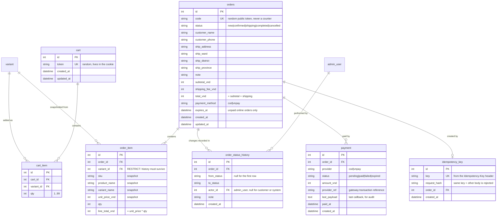

# ERD · P2 Cart, orders, payments

Implemented in migration `0003` (module `app/modules/orders`). Money is integer VND. Customers have no accounts.
`variant` comes from P1 (catalog) and `admin_user` from P0 (auth); everything else is new in P2.

## Table notes

- **`orders`** is named plural because `order` is a reserved SQL word. Order status and payment status are separate:
  a `completed` order can have a `pending` COD payment until cash is collected.
- **`order.code`** is a long random token (not a counter), so another customer's order cannot be guessed. Lookup needs
  the code **and** the phone number.
- **`order_item`** copies sku, names and unit price at purchase time. Later price edits or a hidden product never
  change an old order. `variant_id` is `RESTRICT`, and variants are never deleted anyway.
- **`cart_item`** has `UNIQUE(cart_id, variant_id)`: adding the same variant again raises the quantity. The cart never
  stores a price; it is read from the catalog every time.
- **`payment`** has `UNIQUE(provider, provider_ref)`, so the same gateway callback arriving twice cannot create or flip
  a payment twice.
- **`idempotency_key`**: a repeated checkout with the same key and the same body returns the same order; the same key
  with a different body is an error.

## Rules the schema enforces (check constraints)

- `qty` between 1 and 99; `unit_price_vnd`, `subtotal_vnd`, `shipping_fee_vnd`, `total_vnd`, `amount_vnd` are `>= 0`.
- `total_vnd = subtotal_vnd + shipping_fee_vnd` and `line_total_vnd = unit_price_vnd * qty`.
- `status`, `payment_method`, `provider` and payment `status` only accept the listed values.

## Decisions this draft assumes (change them now, not after the migration)

1. **Shipping fee (D4):** flat fee, free above a threshold. Suggested 30,000đ and free from 300,000đ; kept in settings,
   not in the database. *Need your numbers.*
2. **Stock:** no stock columns here. P3 adds `inventory` tables and a `StockProvider`; P2 only calls a no-op
   `reserve()` / `release()` seam so P3 can plug in without changing orders.
3. **Attribution:** `orders` has no UTM or campaign columns yet. P4 adds them in its own migration, when the
   attribution rule (window, first vs. last touch) is decided.
4. **Abandoned carts** are never deleted by P2; a cleanup job can come later.
5. **Online payment expiry:** `orders.expires_at` is set only for unpaid online orders (suggested 15 minutes). A job
   marks the payment `expired` and the order `cancelled` once.
