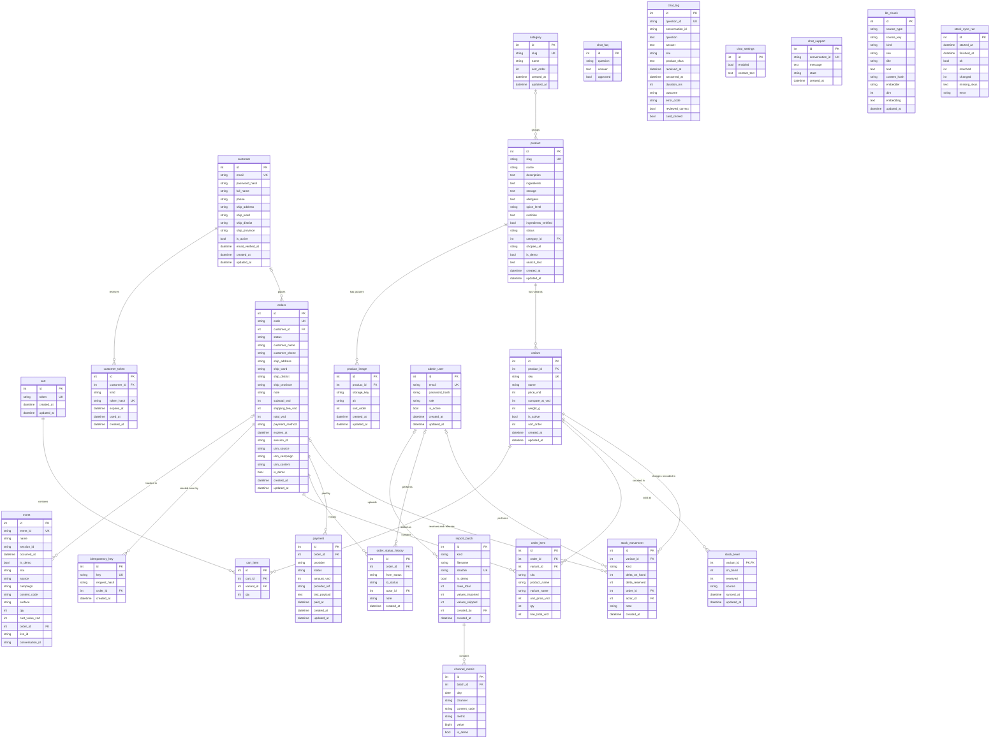
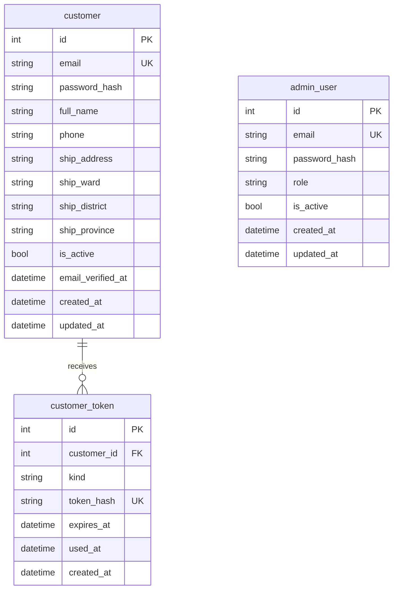
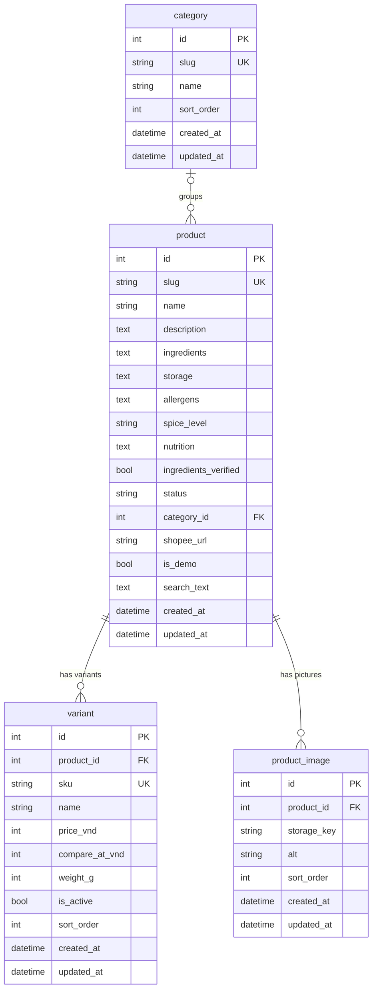
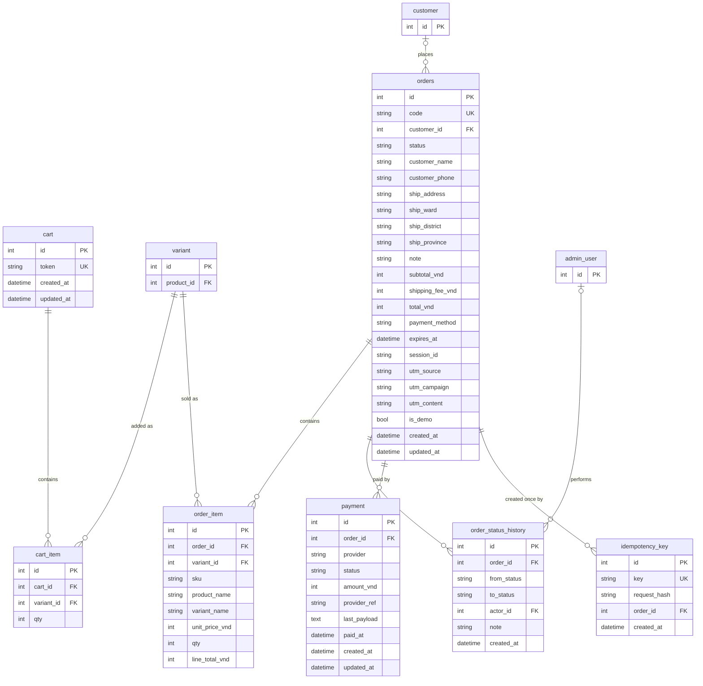
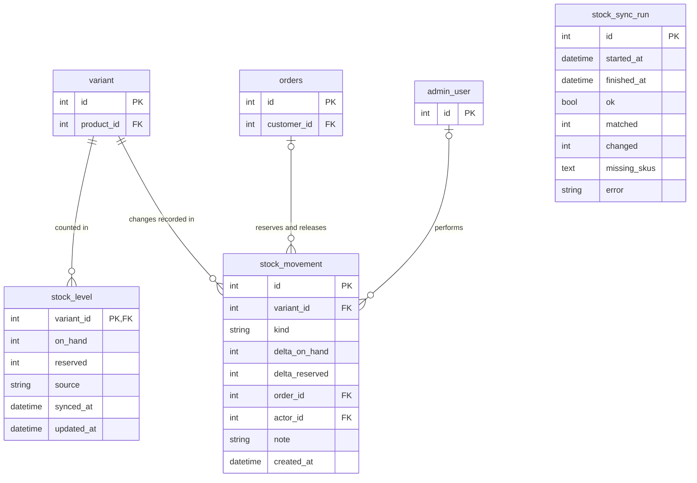
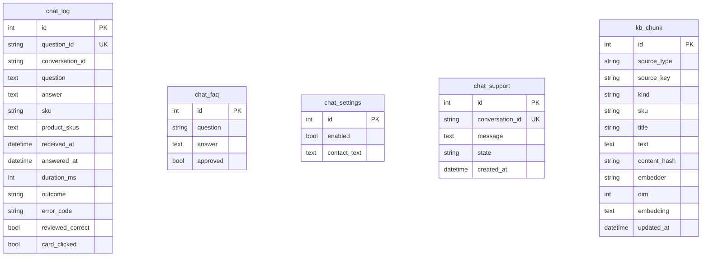
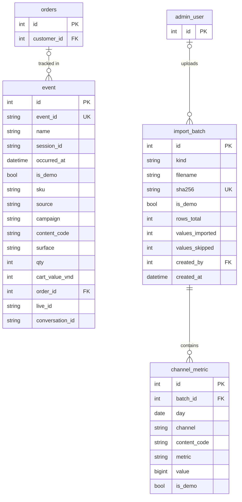

# Database design (ERD)

PostgreSQL in production, SQLite for the fast unit-test run. The schema is owned by Alembic (`api/alembic/versions`, one linear
history). **25 tables**: the first diagram shows all of them with every column, then one diagram per module.
The diagrams were taken from the SQLAlchemy models (`api/app/modules/*/models.py`); update this page in the same pull request that changes a model.

Conventions: money is integer VND; timestamps are UTC; a missing value is `NULL` plus a status, never `0`.
`PK` primary key, `FK` foreign key, `UK` unique. A relationship drawn with `|o` on the parent side means the foreign key is optional.

## Whole schema

## Accounts and staff

## Catalog

## Cart, orders and payments

## Inventory

## Chatbot and knowledge base

## Analytics

## Design notes

- **Orders are snapshots.** `order_item` copies name, SKU and price when the order is placed, so later catalog edits never change history.
  `orders.code` is a random public token (never a counter); the customer sees only their own orders.
- **Stock is a ledger.** `stock_level` holds the current `on_hand` and `reserved`; every change also writes a `stock_movement` row.
  Reserving stock happens in the same database transaction as creating the order.
- **Payments are separate from orders** (`payment`), so "completed" and "paid" can differ (cash on delivery, payOS).
- **Customer tokens** (`customer_token`) store only the SHA-256 hash of an e-mail link token, never the token itself.
- **Chatbot passages** (`kb_chunk`) are derived data rebuilt from products, approved FAQs and policy files; they can be dropped and rebuilt.
- **Real and demo data** are flagged (`is_demo`) and never mixed silently in a report.
