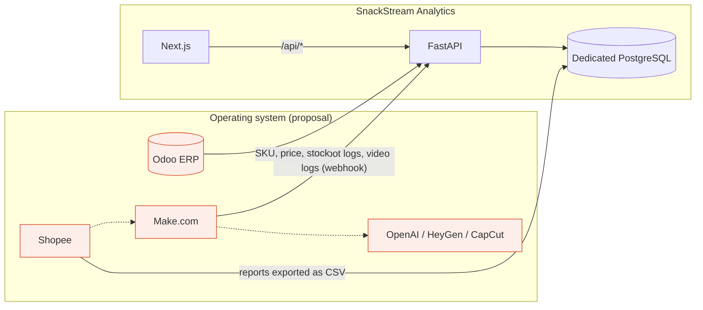

# Architecture

The dashboard is an **observer**: it sits outside the operating flow shown in Figure 1 of the proposal. It only reads/receives data and never writes
back to Shopee or Odoo.

| From | Data | How it arrives |
|---|---|---|
| Shopee / TikTok / Facebook | views, clicks, ads, add-to-cart | CSV/Excel on `/data` (APIs not verified yet) |
| Make.com (orders, logs) | Shopee orders, chatbot logs, AI Live logs, video logs | `POST /api/ingest/make` |
| Odoo | SKU, price, stock | adapter not written yet; CSV `products` for now |
| Team website | sessions, product views, clicks to Shopee | `/shop` records events directly |

## Life of a request

Browser → Next.js (`/`) → a server component calls FastAPI with the session cookie → FastAPI aggregates with `analytics.py` + `metrics.py`
(the single place where formulas are defined) → JSON → React renders it; a missing number always carries a status and is never shown as 0.

Metric dictionary and formulas: the `/metrics` page, source in `apps/api/app/metrics.py`.
